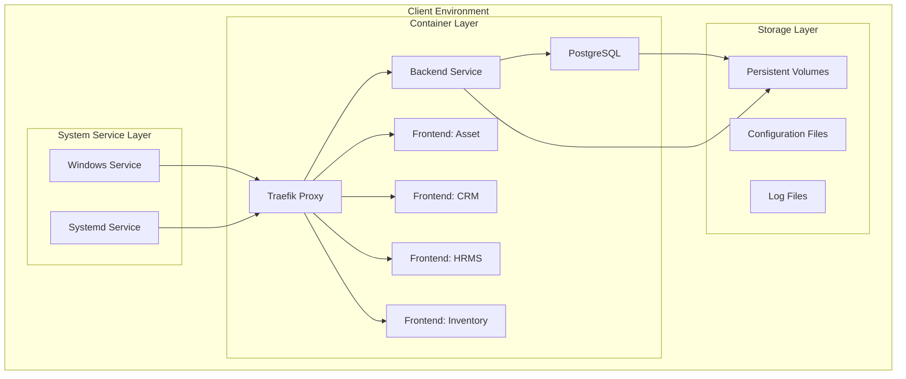

# Aria ERP On-Premise Deployment Infrastructure Specification

**Document Version:** 1.0  
**Created:** October 3, 2025  
**Project:** Aria ERP Monorepo  
**Branch Name:** `feature/onprem-deployment-infra`

## 1. Executive Summary

This specification defines the infrastructure layer for deploying Aria ERP as a compiled, distributable package to client on-premise environments. The solution enables secure, professional deployment across Windows and Linux systems with modular frontend selection based on client licensing.

### 1.1 Business Context

- **Deployment Model**: On-premise client installations via USB/FTP transfer
- **Target Environments**: Windows and Linux servers/computers
- **Licensing Model**: Single backend with selective frontend modules (Asset, CRM, HRMS, Inventory)
- **Security Requirements**: Code obfuscation, proper signing, system service integration

## 2. Requirements Analysis

### 2.1 Functional Requirements

| ID     | Requirement                | Priority | Description                                          |
| ------ | -------------------------- | -------- | ---------------------------------------------------- |
| FR-001 | Compiled Distribution      | Critical | Generate deployment packages without raw source code |
| FR-002 | Cross-Platform Support     | Critical | Support Windows and Linux deployment targets         |
| FR-003 | Modular Frontend Selection | Critical | Include only licensed frontend applications          |
| FR-004 | System Service Integration | High     | Deploy as native system service with auto-restart    |
| FR-005 | Code Protection            | High     | Obfuscate/minify all application code                |
| FR-006 | Digital Signing            | High     | Sign Windows deployments with valid certificates     |
| FR-007 | Database Integration       | Critical | Include PostgreSQL with automated setup              |
| FR-008 | Configuration Management   | High     | Environment-specific configuration system            |

### 2.2 Non-Functional Requirements

| ID      | Requirement     | Priority | Description                                        |
| ------- | --------------- | -------- | -------------------------------------------------- |
| NFR-001 | Security        | Critical | No exposed source code or development artifacts    |
| NFR-002 | Reliability     | High     | 99.9% uptime with automatic service recovery       |
| NFR-003 | Performance     | Medium   | <30 second startup time, <100MB memory overhead    |
| NFR-004 | Maintainability | High     | Simple update/upgrade mechanisms                   |
| NFR-005 | Documentation   | High     | Professional deployment guides and troubleshooting |

## 3. Architecture Design

### 3.1 Distribution Package Structure

```
aria-erp-v{version}/
├── bin/
│   ├── install-linux.sh           # Linux installation script
│   ├── install-windows.ps1        # Windows installation script
│   ├── uninstall-linux.sh         # Linux removal script
│   ├── uninstall-windows.ps1      # Windows removal script
│   ├── load-images.sh             # Load Docker images (Linux)
│   └── load-images.ps1            # Load Docker images (Windows)
├── images/
│   └── *.tar                      # Pre-built Docker images
├── config/
│   └── traefik/                   # Traefik proxy configuration
├── docs/
│   ├── INSTALLATION.md            # Installation guide
│   ├── CONFIGURATION.md           # Configuration reference
│   ├── SPECIFICATION.md           # Technical specifications
│   └── TROUBLESHOOTING.md         # Troubleshooting guide
├── docker-compose.production.yml  # Production Docker Compose
├── .env.template                  # Environment configuration template
└── VERSION                        # Package version
│       └── linux/           # Systemd service definitions
├── config/
│   ├── templates/           # Configuration templates
│   ├── certificates/       # SSL certificate templates
│   └── environments/       # Environment-specific configs
├── docs/
│   ├── INSTALLATION.md     # Installation guide
│   ├── CONFIGURATION.md    # Configuration reference
│   ├── TROUBLESHOOTING.md  # Common issues and solutions
│   └── MAINTENANCE.md      # Update and maintenance procedures
├── licenses/
│   └── module-licenses.json # Frontend module licensing
└── VERSION                  # Package version information
```

### 3.2 Component Architecture



## 4. Technical Specifications

### 4.1 Build System Integration

#### 4.1.1 New Turborepo Tasks

```json
{
  "tasks": {
    "package": {
      "dependsOn": ["build"],
      "outputs": ["dist/**", "packages/**"],
      "cache": false
    },
    "package:windows": {
      "dependsOn": ["package"],
      "outputs": ["dist/windows/**"],
      "cache": false
    },
    "package:linux": {
      "dependsOn": ["package"],
      "outputs": ["dist/linux/**"],
      "cache": false
    }
  }
}
```

#### 4.1.2 Package Scripts Enhancement

```json
{
  "scripts": {
    "package": "turbo run package",
    "package:prod": "NODE_ENV=production turbo run package",
    "package:windows": "turbo run package:windows",
    "package:linux": "turbo run package:linux",
    "sign:windows": "node scripts/sign-windows-package.js"
  }
}
```

### 4.2 Infrastructure Packages

#### 4.2.1 New Package: `packages/deployment`

```
packages/deployment/
├── src/
│   ├── builders/
│   │   ├── docker-builder.ts    # Docker image compilation
│   │   ├── config-builder.ts    # Configuration generation
│   │   └── package-builder.ts   # Distribution packaging
│   ├── installers/
│   │   ├── windows-installer.ts # Windows service setup
│   │   ├── linux-installer.ts   # Linux systemd setup
│   │   └── base-installer.ts    # Common installation logic
│   ├── signers/
│   │   └── windows-signer.ts    # Code signing utilities
│   └── types/
│       └── deployment.types.ts  # Deployment type definitions
├── templates/
│   ├── docker/                  # Docker Compose templates
│   ├── services/               # Service definition templates
│   └── scripts/                # Installation script templates
└── package.json
```

#### 4.2.2 New Package: `packages/config-deployment`

```
packages/config-deployment/
├── src/
│   ├── environments/
│   │   ├── production.ts       # Production configuration
│   │   ├── staging.ts         # Staging configuration
│   │   └── development.ts     # Development overrides
│   ├── modules/
│   │   └── license-config.ts  # Module licensing logic
│   └── validators/
│       └── config-validator.ts # Configuration validation
└── package.json
```

### 4.3 Docker Infrastructure

#### 4.3.1 Production Docker Compose Template

```yaml
# templates/docker/docker-compose.production.yml
version: '3.8'

services:
  traefik:
    image: traefik:v3.5
    container_name: aria-proxy
    restart: unless-stopped
    command:
      - '--providers.docker=true'
      - '--providers.file.directory=/etc/traefik/dynamic'
      - '--entrypoints.web.address=:80'
      - '--entrypoints.websecure.address=:443'
      - '--certificatesresolvers.letsencrypt.acme.httpchallenge=true'
      - '--certificatesresolvers.letsencrypt.acme.email=${ACME_EMAIL}'
      - '--certificatesresolvers.letsencrypt.acme.storage=/letsencrypt/acme.json'
    ports:
      - '80:80'
      - '443:443'
    volumes:
      - /var/run/docker.sock:/var/run/docker.sock:ro
      - ./config/traefik:/etc/traefik/dynamic:ro
      - ./volumes/letsencrypt:/letsencrypt
    networks:
      - aria-network

  postgres:
    image: postgres:18-alpine
    container_name: aria-database
    restart: unless-stopped
    environment:
      POSTGRES_DB: ${POSTGRES_DB:-aria}
      POSTGRES_USER: ${POSTGRES_USER:-aria}
      POSTGRES_PASSWORD: ${POSTGRES_PASSWORD}
    volumes:
      - ./volumes/postgres:/var/lib/postgresql/data
      - ./config/postgres/init:/docker-entrypoint-initdb.d:ro
    networks:
      - aria-network
    healthcheck:
      test: ['CMD-SHELL', 'pg_isready -d ${POSTGRES_DB:-aria} -U ${POSTGRES_USER:-aria}']
      interval: 30s
      timeout: 10s
      retries: 5

  backend:
    image: aria/backend:${VERSION}
    container_name: aria-backend
    restart: unless-stopped
    depends_on:
      postgres:
        condition: service_healthy
    environment:
      NODE_ENV: production
      DATABASE_URL: postgresql://${POSTGRES_USER:-aria}:${POSTGRES_PASSWORD}@postgres:5432/${POSTGRES_DB:-aria}
      REDIS_URL: redis://redis:6379
    volumes:
      - ./volumes/uploads:/app/uploads
      - ./logs/backend:/app/logs
    networks:
      - aria-network
    labels:
      - 'traefik.enable=true'
      - 'traefik.http.routers.backend.rule=Host(`${DOMAIN}`) && PathPrefix(`/api`)'
      - 'traefik.http.routers.backend.tls.certresolver=letsencrypt'

networks:
  aria-network:
    driver: bridge

volumes:
  postgres-data:
  redis-data:
```

### 4.4 Windows Service Integration

#### 4.4.1 Service Definition Template

```xml
<!-- templates/services/windows/aria-service.xml -->
<service>
  <id>aria-erp</id>
  <name>Aria ERP System</name>
  <description>Aria B2B ERP Suite - Enterprise Resource Planning System</description>
  <executable>docker-compose</executable>
  <arguments>-f docker-compose.yml up</arguments>
  <workingdirectory>%BASE%</workingdirectory>
  <stoptimeout>30 sec</stoptimeout>
  <startmode>Automatic</startmode>
  <delayedAutoStart>false</delayedAutoStart>
  <onfailure action="restart" delay="10 sec"/>
  <onfailure action="restart" delay="20 sec"/>
  <onfailure action="none"/>
  <resetfailure>1 hour</resetfailure>
  <serviceaccount>
    <domain>NT AUTHORITY</domain>
    <user>LocalService</user>
    <allowservicelogon>true</allowservicelogon>
  </serviceaccount>
</service>
```

#### 4.4.2 PowerShell Installation Script

```powershell
# templates/scripts/install.ps1
param(
    [Parameter(Mandatory=$true)]
    [string]$InstallPath,

    [Parameter(Mandatory=$false)]
    [string[]]$Modules = @("asset", "crm", "hrms", "inventory"),

    [Parameter(Mandatory=$false)]
    [string]$Domain = "localhost",

    [Parameter(Mandatory=$false)]
    [switch]$SkipServiceInstall
)

# Script implementation follows...
```

### 4.5 Linux Systemd Integration

#### 4.5.1 Systemd Service Template

```ini
# templates/services/linux/aria-erp.service
[Unit]
Description=Aria ERP System
After=docker.service
Requires=docker.service

[Service]
Type=forking
RemainAfterExit=yes
WorkingDirectory=/opt/aria-erp
ExecStart=/usr/local/bin/docker-compose up -d
ExecStop=/usr/local/bin/docker-compose down
ExecReload=/usr/local/bin/docker-compose restart
TimeoutStartSec=0
Restart=on-failure
RestartSec=30s

[Install]
WantedBy=multi-user.target
```

## 5. Implementation Plan

### 5.1 Phase 1: Core Infrastructure (Sprint 1-2)

#### 5.1.1 Package Structure Setup

- [ ] Create `packages/deployment` with builders and installers
- [ ] Create `packages/config-deployment` with environment management
- [ ] Update root `package.json` with packaging scripts
- [ ] Extend `turbo.json` with packaging tasks

#### 5.1.2 Docker Image Optimization

- [ ] Create production-optimized Dockerfiles
- [ ] Implement multi-stage builds with code obfuscation
- [ ] Add health checks and proper signal handling
- [ ] Create Docker image pre-building system

### 5.2 Phase 2: Platform-Specific Integration (Sprint 3-4)

#### 5.2.1 Windows Service Implementation

- [ ] Implement Windows service wrapper using WinSW
- [ ] Create PowerShell installation scripts
- [ ] Add code signing integration with certificates
- [ ] Implement Windows-specific configuration management

#### 5.2.2 Linux Systemd Implementation

- [ ] Create systemd service definitions
- [ ] Implement bash installation scripts
- [ ] Add Linux-specific security hardening
- [ ] Implement log rotation and monitoring

### 5.3 Phase 3: Module Licensing & Distribution (Sprint 5-6)

#### 5.3.1 Frontend Module Selection

- [ ] Implement license-based module inclusion/exclusion
- [ ] Create module configuration system
- [ ] Add runtime module verification
- [ ] Implement graceful module loading/unloading

#### 5.3.2 Distribution Packaging

- [ ] Create automated packaging pipeline
- [ ] Implement version management and checksums
- [ ] Add package validation and testing
- [ ] Create distribution artifact generation

### 5.4 Phase 4: Documentation & Testing (Sprint 7-8)

#### 5.4.1 Documentation Suite

- [ ] Create comprehensive installation guides
- [ ] Document configuration options and troubleshooting
- [ ] Create maintenance and update procedures
- [ ] Add security best practices documentation

#### 5.4.2 Testing Infrastructure

- [ ] Create automated installation testing
- [ ] Implement cross-platform compatibility testing
- [ ] Add upgrade/downgrade testing scenarios
- [ ] Create performance benchmarking

## 6. File System Changes

### 6.1 New Directory Structure

```
/Aria/
├── packages/
│   ├── deployment/              # NEW: Deployment utilities
│   ├── config-deployment/       # NEW: Deployment configurations
│   └── ...existing packages
├── deployment/                  # NEW: Deployment infrastructure
│   ├── docker/
│   │   ├── production/         # Production Docker configurations
│   │   └── images/             # Custom Docker images
│   ├── services/
│   │   ├── windows/            # Windows service definitions
│   │   └── linux/              # Linux systemd services
│   ├── scripts/
│   │   ├── install/            # Installation scripts
│   │   ├── update/             # Update scripts
│   │   └── signing/            # Code signing utilities
│   ├── templates/              # Configuration templates
│   ├── certificates/           # Certificate management
│   └── docs/                   # Deployment documentation
└── ...existing structure
```

### 6.2 Modified Files

#### 6.2.1 Root Package Configuration

```json
// package.json additions
{
  "scripts": {
    "package": "turbo run package",
    "package:windows": "turbo run package:windows",
    "package:linux": "turbo run package:linux",
    "sign:windows": "node deployment/scripts/signing/sign-windows.js"
  },
  "devDependencies": {
    "@aria/deployment": "workspace:*",
    "@aria/config-deployment": "workspace:*"
  }
}
```

#### 6.2.2 Turborepo Configuration

```json
// turbo.json additions
{
  "tasks": {
    "package": {
      "dependsOn": ["build"],
      "outputs": ["dist/**", "deployment/dist/**"],
      "cache": false
    }
  }
}
```

## 7. Security Considerations

### 7.1 Code Protection

- Implement TypeScript/JavaScript obfuscation using tools like `terser` and `webpack-obfuscator`
- Remove all source maps and debugging information from production builds
- Implement runtime license validation to prevent unauthorized module access

### 7.2 Windows Code Signing

- Integration with Sectigo/DigiCert code signing certificates
- Automated signing pipeline using hardware security modules (HSMs) or cloud signing services
- Timestamping to ensure signature validity beyond certificate expiration

### 7.3 Runtime Security

- Implement container security scanning in build pipeline
- Use non-root users in all containers
- Enable Docker security options (seccomp, AppArmor)
- Implement secret management for database credentials and API keys

## 8. Quality Assurance

### 8.1 Testing Strategy

- **Unit Testing**: Test all deployment utilities and configuration builders
- **Integration Testing**: Validate complete installation on clean Windows/Linux systems
- **Performance Testing**: Measure startup times, memory usage, and resource consumption
- **Security Testing**: Validate code obfuscation and license enforcement

### 8.2 Acceptance Criteria

- [ ] Successful installation on Windows Server 2019/2022
- [ ] Successful installation on Ubuntu 20.04/22.04 and CentOS 8/9
- [ ] Service starts automatically on system boot
- [ ] Service restarts automatically on failure
- [ ] All frontend modules load correctly based on licensing
- [ ] No raw source code visible in distribution package
- [ ] Windows package is properly signed and trusted
- [ ] Documentation is clear and actionable

## 9. Maintenance & Support

### 9.1 Update Mechanism

- Implement in-place update system that preserves data and configuration
- Create rollback mechanism for failed updates
- Add health checks during update process

### 9.2 Monitoring & Logging

- Centralized logging with configurable log levels
- Service health monitoring and alerting
- Performance metrics collection and reporting

### 9.3 Support Tools

- Diagnostic script for troubleshooting common issues
- Configuration validation utility
- System requirements checker

## 10. Success Metrics

| Metric                    | Target      | Measurement                             |
| ------------------------- | ----------- | --------------------------------------- |
| Installation Success Rate | >95%        | Automated testing across platforms      |
| Service Uptime            | >99.9%      | System monitoring over 30 days          |
| Installation Time         | <15 minutes | Timed installation on standard hardware |
| Package Size              | <500MB      | Distribution package compression        |
| Memory Usage              | <512MB      | Runtime resource monitoring             |
| Startup Time              | <30 seconds | Time to healthy service state           |

---
