# Aria Asset Management — Client Getting-Started Guide

> A step-by-step walkthrough for new clients to configure, use, and report on the Asset module from scratch.

---

## Table of Contents

1. [Overview](#1-overview)
2. [How the System Is Organized](#2-how-the-system-is-organized)
3. [Phase 0 — Initial Setup After Deployment](#3-phase-0--initial-setup-after-deployment)
   - 3.1 [Sign In as Admin](#31-sign-in-as-admin)
   - 3.2 [Create Your Company](#32-create-your-company)
   - 3.3 [Create Users and Assign Roles](#33-create-users-and-assign-roles)
4. [Phase 1 — Asset Master Data Setup](#4-phase-1--asset-master-data-setup)
   - 4.1 [Locations](#41-locations)
   - 4.2 [Asset Categories](#42-asset-categories)
5. [Phase 2 — Asset Creation & Management](#5-phase-2--asset-creation--management)
   - 5.1 [Quick Create](#51-quick-create)
   - 5.2 [Full Asset Form](#52-full-asset-form)
   - 5.3 [Asset Status Lifecycle](#53-asset-status-lifecycle)
   - 5.4 [Editing an Asset](#54-editing-an-asset)
   - 5.5 [Deleting an Asset](#55-deleting-an-asset)
6. [Phase 3 — Asset Value Adjustments](#6-phase-3--asset-value-adjustments)
7. [Phase 4 — Asset Maintenance](#7-phase-4--asset-maintenance)
   - 7.1 [Maintenance Teams](#71-maintenance-teams)
   - 7.2 [Maintenance Records](#72-maintenance-records)
   - 7.3 [Maintenance Logs](#73-maintenance-logs)
8. [Phase 5 — Dashboard & Reports](#8-phase-5--dashboard--reports)
   - 8.1 [Dashboard Overview](#81-dashboard-overview)
   - 8.2 [Asset Activity Report](#82-asset-activity-report)
   - 8.3 [Depreciation Ledger Report](#83-depreciation-ledger-report)
   - 8.4 [Depreciations & Balances Report](#84-depreciations--balances-report)
   - 8.5 [Exporting Reports](#85-exporting-reports)
9. [Data Model Reference](#9-data-model-reference)
10. [Known Gaps & Limitations](#10-known-gaps--limitations)

---

## 1. Overview

The Aria Asset Management module lets you track the full lifecycle of your company's fixed assets — from creation through depreciation, maintenance, value adjustments, and disposal. The app is organized into five areas:

| Area | Purpose |
|---|---|
| **Asset Sub-Module** | Assets, Categories, Locations |
| **Asset Maintenance** | Maintenance records, teams, logs |
| **Value Adjustments** | Revaluation and depreciation schedule management |
| **Reports** | Activity, Depreciation Ledger, Depreciations & Balances |
| **Dashboard** | KPIs, charts, alerts |

---

## 2. How the System Is Organized

Before diving in, it helps to understand the two foundational concepts that control access and data in Aria:

| Concept | What It Is | Who Manages It |
|---|---|---|
| **Organization** | Your workspace / tenant. Controls who can log in and which apps they can access. | Created automatically on deployment; managed via Admin > Organizations |
| **Company** | Your business entity (name, country, currency). Used as a label on assets, inventory, and reports. | Must be created manually after deployment; managed via database seed or Admin > Settings |

These two are **not linked** in the system. The Organization controls *access*; Company is *master data*.

### End-to-End Setup Flow

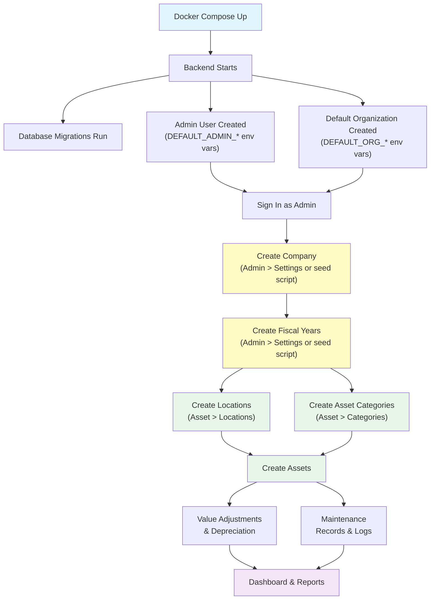

### Entity Relationship Diagram

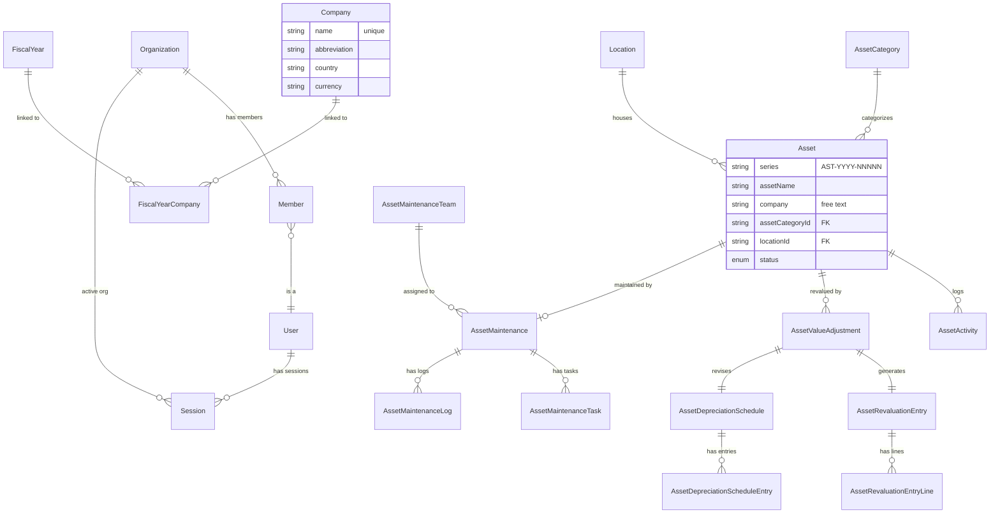

---

## 3. Phase 0 — Initial Setup After Deployment

After your system administrator deploys Aria (via Docker Compose), three things happen automatically:

1. The database schema is created
2. An **admin user** is created (from environment variables)
3. A default **Organization** is created with the admin as owner

However, the following must be set up **manually** before you can start using the Asset module.

### 3.1 Sign In as Admin

Navigate to the application URL and sign in with the admin credentials configured during deployment.

| Field | Value |
|---|---|
| URL | `https://your-domain.com/auth/sign-in` |
| Username | Value of `DEFAULT_ADMIN_USERNAME` (set by your sysadmin) |
| Password | Value of `DEFAULT_ADMIN_PASSWORD` (set by your sysadmin) |

**What happens on first login:**

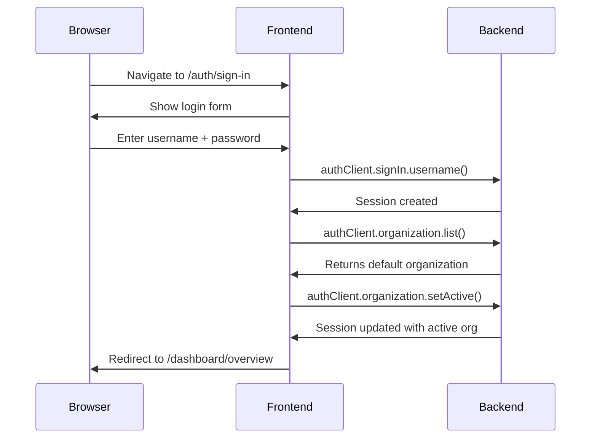

After login, you will see the main dashboard. The sidebar contains links to all modules.

### 3.2 Create Your Company

A **Company** record is required before creating any assets. The company name is used on asset records, reports, and filters.

> **Important**: There is currently no Company creation form in the UI. Company records must be created via the database seed script or directly in the database. Contact your system administrator to run the seed script.

**If using the demo seed script** (recommended for new deployments):

```bash
# From the project root
cd apps/backend
ARIA_ALLOW_DEMO_DATA_MUTATION=true ARIA_DEMO_DATABASE_ISOLATED=true \
  bun prisma/demo-data/cli.ts load --scale=small
```

This creates:

| Entity | Example Value |
|---|---|
| Company | "ACME Corp" — country: India, currency: INR |
| Fiscal Years | 2022-23 through 2026-27 (Indian April-March cycle) |
| Asset Categories | 7 categories (SMT Equipment, Test Instruments, IT, etc.) |
| Locations | Hierarchical locations (Bangalore, Chennai, Hyderabad) |
| Assets | Sample assets with depreciation schedules |

**If creating manually** (for production):

Your system administrator needs to insert a Company record directly into the database:

```sql
INSERT INTO companies (id, name, abbreviation, country, currency, disabled, "createdAt", "updatedAt")
VALUES (gen_random_uuid(), 'Your Company Name', 'YCN', 'India', 'INR', false, NOW(), NOW());
```

And create Fiscal Year records:

```sql
INSERT INTO fiscal_years (id, year, "yearStartDate", "yearEndDate", disabled, "isShortYear", "createdAt", "updatedAt")
VALUES (gen_random_uuid(), '2025-26', '2025-04-01', '2026-03-31', false, false, NOW(), NOW());

-- Link the fiscal year to the company
INSERT INTO fiscal_year_companies (id, "fiscalYearId", "companyId", "createdAt", "updatedAt")
VALUES (gen_random_uuid(), '<fiscal_year_id>', '<company_id>', NOW(), NOW());
```

**Company fields reference:**

| Field | Required | Description | Example |
|---|---|---|---|
| Name | Yes (unique) | Full company name — this is what you type into the Asset form | "Pivotr Technologies Pvt Ltd" |
| Abbreviation | No | Short code | "PIVOTR" |
| Country | No | Country of operation | "India" |
| Currency | No | Reporting currency | "INR" |
| Disabled | No | Set to `true` to deactivate | false |

> **Tip**: The company name you create here must be typed **exactly** (case-insensitive) when creating assets. The asset `company` field is a free-text string, not a dropdown linked to the Company table. Establish a naming convention early and stick to it.

### 3.3 Create Users and Assign Roles

The default admin user has full access to all modules. For your team members, you need to:

1. **Create user accounts** — Admin > Users > Create User
2. **Add users to the organization** — Admin > Organizations > Invite Member

**User creation fields:**

| Field | Required | Description |
|---|---|---|
| Email | Yes | User's email address |
| Name | Yes | Display name |
| Username | Yes | Login username |
| Password | Yes | Initial password |
| Department | No | Free text (e.g., "Finance") |
| Must Change Password | No | Force password change on first login |

**Organization roles:**

| Role | Can Access Asset Module? | Can Manage Users? |
|---|---|---|
| Owner | Yes | Yes |
| Admin | Yes | Yes |
| Member | Yes (if added to correct org) | No |

> **Note on access control**: The Asset module checks that users belong to an organization. The default admin user (super_admin) bypasses this check. Regular users must be added as members of an organization to access any module.

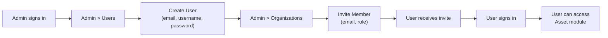

---

## 4. Phase 1 — Asset Master Data Setup

With your Company and users in place, the next step is to create the master data that assets reference: **Locations** and **Asset Categories**.

### Setup Dependency Diagram

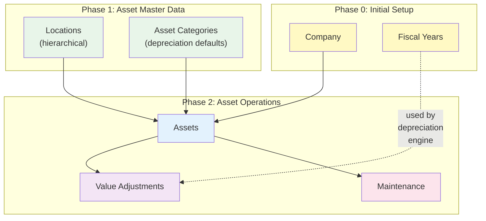

### 4.1 Locations

Locations represent where your assets are physically kept. They follow a **hierarchical tree** structure:

- **Group nodes** act as folders (e.g., "Pivotr Bangalore")
- **Leaf nodes** are actual physical places (e.g., "Peenya Production Floor")

**Navigate to**: Asset > Locations > Create Location

**Fields:**

| Field | Required | Description |
|---|---|---|
| Name | Yes | Unique location name |
| Is Group | Yes | Toggle: `true` for a parent folder, `false` for a leaf location |
| Parent Location | No | Select the parent group (only group-type locations appear in the dropdown) |

**How to build the hierarchy:**

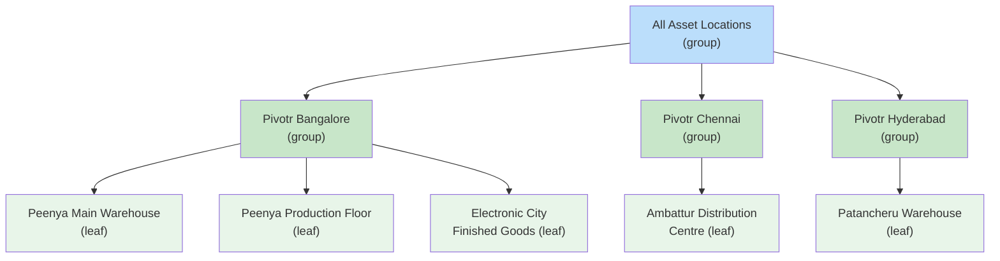

**Step-by-step:**

1. **Create the root group**: Name = "All Asset Locations", Is Group = Yes, Parent = (none)
2. **Create site groups**: Name = "Pivotr Bangalore", Is Group = Yes, Parent = "All Asset Locations"
3. **Create leaf locations**: Name = "Peenya Main Warehouse", Is Group = No, Parent = "Pivotr Bangalore"

**Rules:**
- Location names must be unique across the entire system.
- You cannot delete a location that is assigned to any asset.
- Only group-type locations can be parents.

### 4.2 Asset Categories

Asset Categories define **depreciation defaults** that automatically apply to every asset assigned to that category. Categories are a flat list (no hierarchy).

**Navigate to**: Asset > Asset Categories > Create Category

**Fields:**

| Field | Required | Description |
|---|---|---|
| Name | Yes | Unique category name |
| Depreciation Method | No | `Straight Line`, `Double Declining Balance`, `Written Down Value`, or `Manual` |
| Total Number of Depreciations | No | Total depreciation periods (e.g., 60) |
| Frequency of Depreciation | No | Period length in months (e.g., 12 = yearly) |
| Daily Prorata Based | No | Use daily pro-rata within periods |
| Shift Based | No | Depreciation varies by shift usage |
| Rate of Depreciation | No | Depreciation rate percentage |
| Expected Value After Useful Life | No | Salvage / residual value |
| Non-Depreciable Category | No | If checked, assets in this category will not be depreciated |
| Enable CWIP Accounting | No | Capital Work in Progress accounting flag |

**Example categories:**

| Category | Method | Periods | Frequency | Depreciable? |
|---|---|---|---|---|
| SMT & PCB Assembly Equipment | Written Down Value | 60 | Monthly | Yes |
| Test & Calibration Instruments | Straight Line | 36 | Quarterly | Yes |
| IT Infrastructure & End-User Devices | Straight Line | 36 | Monthly | Yes |
| Warehouse & Material Handling Assets | Straight Line | 48 | Quarterly | Yes |
| Vehicles & Transport | Written Down Value | 60 | Monthly | Yes |
| Leasehold Improvements | — | — | — | No (non-depreciable) |
| CWIP | — | — | — | No (CWIP accounting enabled) |

**Cascade behavior:** When you create an asset and select a category, the category's depreciation settings auto-populate into the asset form. You can override them per-asset if needed.

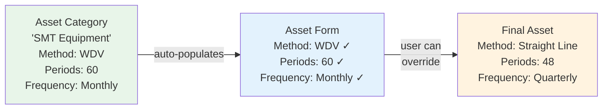

---

## 5. Phase 2 — Asset Creation & Management

With Locations and Categories in place, you can now create assets.

### 5.1 Quick Create

For fast entry, click the **+ New Asset** button on the asset list page. A dialog appears with four fields:

| Field | Required | Description |
|---|---|---|
| Asset Name | Yes | Name of the asset |
| Company | Yes | Company that owns the asset (free text — type the exact company name) |
| Category | No | Asset category (searchable dropdown) |
| Location | No | Location (searchable dropdown) |

After quick-create, you can click **Edit Full Form** to add purchase details, insurance, depreciation, and ownership information.

### 5.2 Full Asset Form

The full form at `/asset/asset-sub-module/asset/form` is organized into **five sections**:

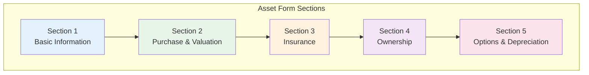

#### Section 1 — Basic Information

| Field | Required | Type | Notes |
|---|---|---|---|
| Asset Name | Yes | Text | Max 255 characters |
| Company | Yes | Text | Free text — must match an existing Company name exactly |
| Item Code | No | Text | Link to inventory item code |
| Asset Category | No | Searchable dropdown | Populated from Asset Categories master |
| Location | No | Searchable dropdown | Populated from Locations master |
| Custodian | No | Text | Person responsible for the asset |
| Department | No | Text | Free text (e.g., "Manufacturing Engineering") |
| Asset Quantity | No | Number | Defaults to 1 |

#### Section 2 — Purchase & Valuation

| Field | Required | Type | Notes |
|---|---|---|---|
| Purchase Date | No | Date | |
| Available For Use Date | No | Date | Triggers depreciation start date |
| Net Purchase Amount | No | Number | Purchase cost (step 0.01) |
| Purchase Receipt | No | Text | Document reference (e.g., "PR-00001") |
| Purchase Invoice | No | Text | Invoice reference (e.g., "PI-00001") |

#### Section 3 — Insurance

| Field | Required | Type | Notes |
|---|---|---|---|
| Policy Number | No | Text | |
| Insurer | No | Text | Insurance company name |
| Insured Value | No | Number | |
| Insurance Start Date | No | Date | |
| Insurance End Date | No | Date | |

#### Section 4 — Ownership

| Field | Required | Type | Notes |
|---|---|---|---|
| Asset Owner | No | Select | `Company` (default), `Supplier`, or `Customer` |
| Owner Company | Conditional | Text | Shown when owner = Company |
| Supplier | Conditional | Text | Shown when owner = Supplier |
| Customer | Conditional | Text | Shown when owner = Customer |

#### Section 5 — Options & Depreciation

| Field | Required | Type | Notes |
|---|---|---|---|
| Calculate Depreciation | No | Checkbox | Enables depreciation fields below |
| Is Fully Depreciated | No | Checkbox | |
| Maintenance Required | No | Checkbox | Enables maintenance module for this asset |

**When "Calculate Depreciation" is checked, additional fields appear:**

| Field | Required | Type | Notes |
|---|---|---|---|
| Depreciation Method | Yes | Select | Auto-populated from category |
| Total Number of Depreciations | Conditional | Number | Total periods (e.g., 60) |
| Frequency of Depreciation | Conditional | Number | Period length in months |
| Expected Value After Useful Life | Conditional | Number | Must be less than purchase amount |
| Depreciation Start Date | Auto | Date | Set to last day of Available For Use Date month |
| Opening Accumulated Depreciation | Conditional | Number | For migrated assets |
| Opening Number of Booked Depreciations | Conditional | Number | Required when opening depreciation > 0 |

**Depreciation validation rules:**
- Expected value after useful life must be less than net purchase amount
- Opening accumulated depreciation cannot exceed (purchase amount - salvage value)
- Total depreciations must be greater than opening booked depreciations
- Depreciation start date must be on or after purchase date and available-for-use date

**Auto-generated fields (you do not set these):**
- **Series**: Auto-generated as `AST-YYYY-NNNNN` (e.g., `AST-2026-00001`)
- **Value After Depreciation**: Calculated as `max(purchaseAmount - openingAccumulatedDepreciation, 0)`
- **Is Fully Depreciated**: Derived from value after depreciation being zero or negative

### 5.3 Asset Status Lifecycle

Assets move through the following statuses:

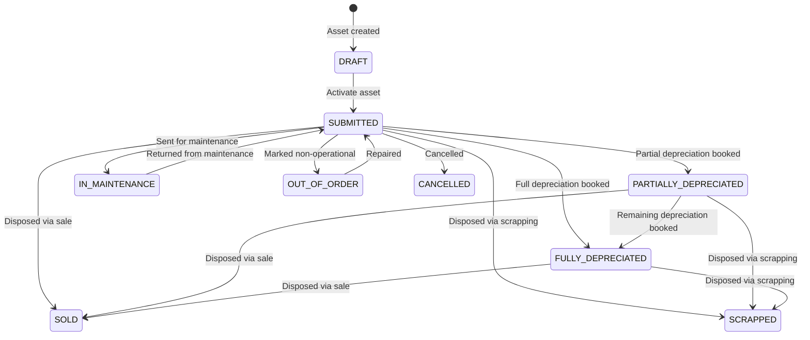

| Status | Description | Can Edit? | Can Delete? |
|---|---|---|---|
| DRAFT | Initial state on creation | Yes | Yes |
| SUBMITTED | Active asset | Yes | No (cancel first) |
| CANCELLED | Cancelled asset | No | No |
| PARTIALLY_DEPRECIATED | Some depreciation booked | Yes | No |
| FULLY_DEPRECIATED | All depreciation booked | Yes | No |
| SOLD | Disposed via sale | Yes | No |
| SCRAPPED | Disposed via scrapping | Yes | No |
| IN_MAINTENANCE | Under maintenance | Yes | No |
| OUT_OF_ORDER | Non-operational | Yes | No |

### 5.4 Editing an Asset

Navigate to the asset detail page (`/asset/asset-sub-module/asset/[assetId]`) and click Edit. All fields are editable except the status field, which is displayed as read-only.

**Rules:**
- You cannot update a CANCELLED asset.
- When you change the category, depreciation defaults from the new category apply unless you override them.
- An activity log entry is automatically created on every update.

### 5.5 Deleting an Asset

- **Single delete**: Click the row actions menu on the asset list and select Delete.
- **Bulk delete**: Select multiple assets using checkboxes and click the bulk delete button.
- A confirmation dialog appears before deletion.
- **You cannot delete SUBMITTED assets.** Cancel them first.

---

## 6. Phase 3 — Asset Value Adjustments

Value Adjustments let you revalue assets (increase or decrease) and automatically generate revised depreciation schedules and journal entries.

**Navigate to**: Asset Maintenance > Value Adjustment

**Value Adjustment Lifecycle:**

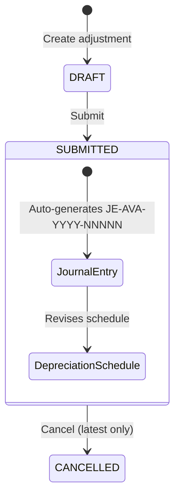

**Workflow:**

1. **Create** a value adjustment (status: DRAFT)
   - Select the asset
   - Enter the new value and difference account
   - Optionally specify a cost center and notes
   - The system shows a **preview** with the calculated difference, direction (INCREASE/DECREASE), and a revised depreciation schedule

2. **Submit** the adjustment (status: SUBMITTED)
   - A revaluation journal entry is automatically generated (series: `JE-AVA-YYYY-NNNNN`)
   - The depreciation schedule is revised
   - The asset's depreciation fields are updated

3. **Cancel** if needed (status: CANCELLED)
   - Only the latest submitted adjustment can be cancelled (preserves audit trail)
   - The journal entry is reversed

**Auto-generated fields:**
- **Adjustment Series**: `AVA-YYYY-NNNNN`
- **Journal Entry Series**: `JE-AVA-YYYY-NNNNN`

**Rules:**
- Value adjustments are only allowed on active assets (not DRAFT, CANCELLED, SOLD, or SCRAPPED).
- Preview shows validation messages for any issues before submission.

---

## 7. Phase 4 — Asset Maintenance

### 7.1 Maintenance Teams

Before creating maintenance records, set up your maintenance teams.

**Navigate to**: Asset Maintenance > Maintenance Team > Create Team

**Fields:**

| Field | Required | Description |
|---|---|---|
| Team Name | Yes | Unique team name |
| Company | Yes | Company the team belongs to |
| Manager | No | Team manager |
| Members | No | List of team members with roles |

### 7.2 Maintenance Records

Maintenance records define **what maintenance an asset needs** and **when**. Each asset can have one maintenance record with multiple tasks.

**Navigate to**: Asset Maintenance > Maintenance > Create Maintenance

**Fields:**

| Field | Required | Description |
|---|---|---|
| Asset | Yes | The asset being maintained |
| Maintenance Team | Yes | Team responsible |
| Tasks | Yes | One or more maintenance tasks |

**Each task has:**

| Field | Required | Description |
|---|---|---|
| Task Name | Yes | Description of the task |
| Task Type | Yes | `Preventive Maintenance` or `Calibration` |
| Periodicity | Yes | `Daily`, `Weekly`, `Monthly`, `Quarterly`, `Half Yearly`, `Yearly`, `Two Yearly`, `Three Yearly` |
| Assignee | No | Person assigned to the task |
| Start Date | Yes | When maintenance begins |

**Maintenance statuses**: `PLANNED`, `OVERDUE`, `CANCELLED`

### 7.3 Maintenance Logs

Maintenance logs track **completed or cancelled tasks**.

**Navigate to**: Asset Maintenance > Log

- **Complete a log**: Marks the task as done, records completion date and certificate details.
- **Cancel a log**: Marks the task as cancelled with a reason.
- Overdue tasks are automatically flagged by the system.

---

## 8. Phase 5 — Dashboard & Reports

### 8.1 Dashboard Overview

The dashboard at `/asset/dashboard/overview` provides an at-a-glance view of your asset portfolio.

**KPI Cards (top row):**

| KPI | Description |
|---|---|
| Total Asset Value | Total depreciated value with retention percentage |
| Active Assets | Count of SUBMITTED/PARTIALLY_DEPRECIATED/IN_MAINTENANCE/OUT_OF_ORDER assets |
| Maintenance Due | Count of overdue maintenance tasks |
| Pending Adjustments | Count of DRAFT value adjustments |

**Charts:**

| Chart | Type | Description |
|---|---|---|
| Depreciation Trend | Area chart | Monthly depreciation amounts from active schedules |
| Status Distribution | Donut chart | Asset count grouped by status |
| Value by Category | Horizontal bar | Purchase value vs current value by category (top 10) |
| Asset Value by Location | Vertical bar | Total depreciated value per location (top 10) |

**Alert Panels:**

| Panel | Description |
|---|---|
| Maintenance Due | Tasks due within 90 days with urgency badges |
| Recent Activity | Latest 10 asset activity entries |
| Insurance Expiry | Policies expiring within 90 days |
| Value Adjustments Summary | Adjustment counts by status with progress bars |

The dashboard updates in **real-time** via WebSocket subscriptions — changes to assets, adjustments, and maintenance trigger automatic refreshes.

### 8.2 Asset Activity Report

**Purpose**: Review the append-only activity trail for asset creation, updates, and value adjustments.

**Navigate to**: Reports > Activity Report

**Filters:**

| Filter | Required | Description |
|---|---|---|
| From Date | Yes | Start of date range (defaults to 1 month ago) |
| To Date | Yes | End of date range (defaults to today) |
| Company | No | Case-insensitive company name filter |
| Asset | No | Match on asset series or name |
| Asset Category | No | Match on category name |
| Activity | No | Substring match on activity text |

**Summary statistics**: Row count, distinct asset count, first/last activity timestamps.

**Table columns**: Recorded At, Asset (name + series), Asset Category, Company, Current Status (color-coded badge), Activity (text).

### 8.3 Depreciation Ledger Report

**Purpose**: Review schedule-backed depreciation history showing each individual depreciation entry per period.

**Navigate to**: Reports > Depreciation Ledger

**Filters:**

| Filter | Required | Description |
|---|---|---|
| From Date | Yes | Start of date range (defaults to 1 month ago) |
| To Date | Yes | End of date range (defaults to today) |
| Company | No | Case-insensitive company name filter |
| Asset | No | Match on asset series or name |
| Asset Category | No | Match on category name |
| Cost Center | No | Match on cost center |

**Summary statistics**: Matched asset count, assets with/without ledger rows, row count, total depreciation amount, closing value total.

**Table columns**: Depreciation Date, Asset, Asset Category, Company, Revision Source, Cost Center, Purchase Amount, Opening Accumulated Depreciation, Depreciation Amount, Accumulated Depreciation, Value After Depreciation, Method, Current Status, Purchase Date.

**Note**: A warning banner appears when some matched assets lack ledger rows in the date range.

### 8.4 Depreciations & Balances Report

**Purpose**: A balance-sheet-style report showing opening balances, depreciation, disposal elimination, revaluation, and closing carrying values.

**Navigate to**: Reports > Depreciations & Balances

**Filters:**

| Filter | Required | Description |
|---|---|---|
| From Date | Yes | Start of date range (defaults to Jan 1 of current year) |
| To Date | Yes | End of date range (defaults to today) |
| Company | No | Case-insensitive company name filter |
| Group By | Yes | `Asset Category` or `Asset` |
| Asset / Category | No | Depends on groupBy selection |

**Summary statistics**: Matched asset count, row count, total depreciation during period, total value adjustment during period, total net asset value.

**Table columns (up to 17):**

| Column | Description |
|---|---|
| Group | Asset name or category name (based on groupBy) |
| Company | |
| Value as on [opening date] | Computed as day before fromDate |
| Value of New Purchase | |
| Value of Sold Asset | |
| Value of Scrapped Asset | |
| Value of Capitalized Asset | Shown only if any row has non-zero value |
| Revaluation Delta | Green for positive, red for negative |
| Value as on [closing date] | |
| Accumulated Depreciation as on [opening date] | |
| Depreciation During Period | |
| Depreciation Eliminated by Disposal | |
| Depreciation Eliminated via Reversal | Shown only if any row has non-zero value |
| Accumulated Depreciation as on [closing date] | |
| Net Asset Value as on [opening date] | |
| Net Asset Value as on [closing date] | |

**Note**: Dynamic column headers include the actual opening/closing dates.

### 8.5 Exporting Reports

All three reports support **Excel (.xlsx) export**:

1. Apply your desired filters on the report page.
2. Click the **Export** button on the table toolbar.
3. A styled Excel file is downloaded containing:
   - Report title
   - Generation timestamp
   - Active filter summary
   - Column headers and data rows
   - Auto-calculated column widths

**Export file naming:**
- Activity: `asset-activity-{timestamp}.xlsx`
- Depreciation Ledger: `asset-depreciation-ledger-{timestamp}.xlsx`
- Depreciations & Balances: `asset-depreciations-balances-{timestamp}.xlsx`

**How report generation works:**

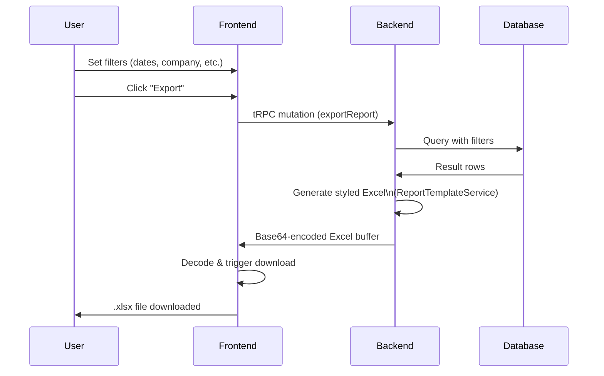

---

## 9. Data Model Reference

### Entity Relationship Summary

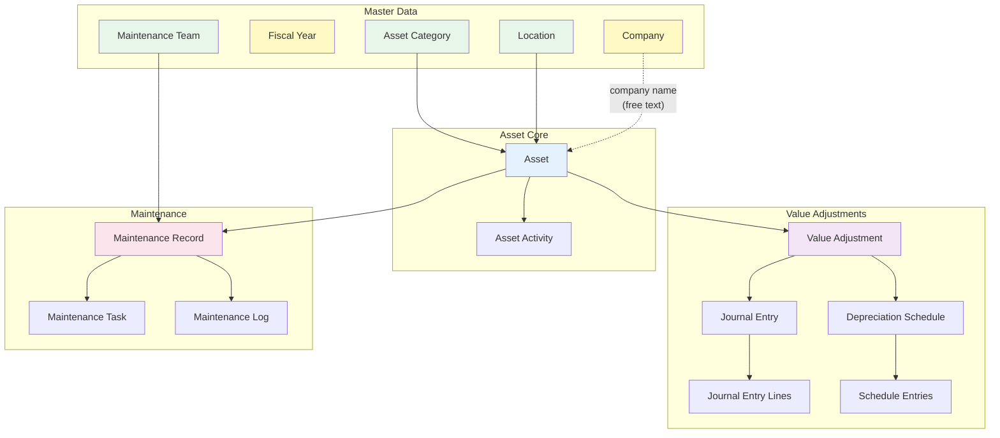

### Auto-Generated Series Numbers

| Entity | Format | Example |
|---|---|---|
| Asset | `AST-YYYY-NNNNN` | AST-2026-00001 |
| Value Adjustment | `AVA-YYYY-NNNNN` | AVA-2026-00001 |
| Revaluation Journal Entry | `JE-AVA-YYYY-NNNNN` | JE-AVA-2026-00001 |

### Supported Depreciation Methods

| Method | Description |
|---|---|
| Straight Line | Equal periodic depreciation: (purchase - salvage) / periods |
| Double Declining Balance | Accelerated at 2x straight-line rate on remaining book value |
| Written Down Value | Diminishing balance method (India-specific) |
| Manual | User-managed depreciation, no automatic schedule |

---

## 10. Known Gaps & Limitations

The following are current limitations to be aware of:

| Gap | Impact | Workaround |
|---|---|---|
| **No Company creation form** | Company records can only be created via database seed script — there is no UI | Contact your system administrator to create Company records |
| **No Fiscal Year management UI** | Fiscal years are seeded via script only — no admin page to create or manage them | Use the demo seed script or database inserts |
| **No approval workflow** | Status transitions (DRAFT → SUBMITTED) are manual with no multi-level approval gate | Use organizational processes outside the system |
| **No asset transfer/movement workflow** | Location changes are direct updates with no source/destination tracking or approval | Activity log records changes but not as a formal transfer document |
| **No barcode/QR code support** | Assets are identified by auto-generated series only | Inventory items have barcode support but it does not extend to assets |
| **No dedicated master tables** for departments, cost centers, vendors, or manufacturers | These fields are free text, leading to potential data inconsistency | Establish naming conventions and train users |
| **Company field is free text on assets** | The asset `company` field is a string, not a foreign key to the Company table | Ensure exact company name spelling across all assets |
| **Locations are not structured by building/floor/room** | Uses generic name hierarchy only | Use naming conventions (e.g., "Bangalore > Peenya > Floor 2") |
| **No PDF export** | Reports export to Excel only; PDF is not implemented | Export to Excel and convert externally |
| **No scheduled/automated reports** | Reports are generated on-demand only | Manually export reports on a regular schedule |
| **No asset register report** | No dedicated "complete asset list with all details" report | Use the asset list page with filters, or the Depreciations & Balances report |
| **No disposal report** | Disposal data appears in the Depreciations & Balances report (Sold/Scrapped columns) but there is no standalone disposal report | Use Depreciations & Balances with date filtering |
| **Asset-to-Inventory link is not enforced** | The `itemCode` field references inventory items but has no foreign key constraint | Verify item codes manually |
| **Organization and Company are unrelated** | The Organization (access control) and Company (business entity) are not linked in the database | Be aware that org membership does not automatically filter by company |

---

## Quick-Start Checklist

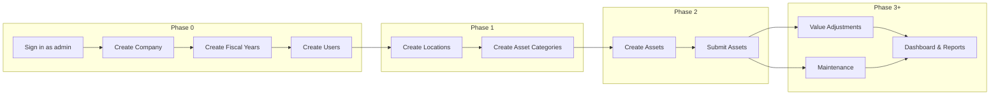

- [ ] **Phase 0 — Initial Setup**
  - [ ] Sign in as admin (credentials from deployment)
  - [ ] Create Company record (via seed script — contact sysadmin)
  - [ ] Create Fiscal Year records (via seed script — contact sysadmin)
  - [ ] Create user accounts (Admin > Users)
  - [ ] Add users to organization (Admin > Organizations)
- [ ] **Phase 1 — Master Data**
  - [ ] Create Locations (hierarchical: groups first, then leaves)
  - [ ] Create Asset Categories with depreciation defaults
- [ ] **Phase 2 — Assets**
  - [ ] Create assets (quick-create for simple ones, full form for detailed entry)
  - [ ] Submit assets to activate them (change status from DRAFT to SUBMITTED)
- [ ] **Phase 3 — Value Adjustments**
  - [ ] Create Value Adjustments to revalue assets and generate depreciation schedules
- [ ] **Phase 4 — Maintenance**
  - [ ] Set up Maintenance Teams
  - [ ] Create Maintenance Records with tasks for assets that need maintenance
- [ ] **Phase 5 — Reporting**
  - [ ] Review the Dashboard for an overview
  - [ ] Run Reports and export to Excel as needed
