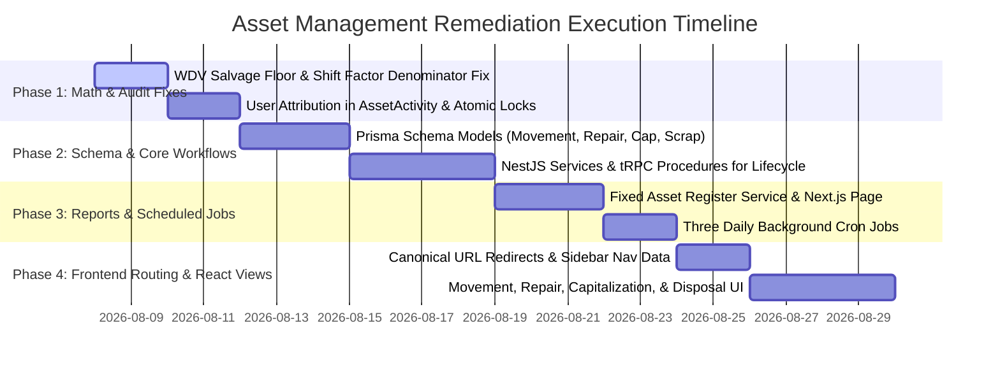

# Asset Management Comprehensive Audit & Gap Analysis Report

> **Target Workspace**: Aria ERP Suite (`apps/backend`, `apps/frontend`, `packages/types`)  
> **Source of Truth for Business Logic**: ERPNext Assets Module (`.erpnext/erpnext/assets`)  
> **Source of Truth for UI/UX**: Aria Monorepo (`apps/frontend/src/app/asset`)  
> **Audit Method**: Deep static code analysis across Python controllers, SQL query builders, Prisma models, NestJS services, tRPC routers, Next.js pages, and unit/E2E test suites.

---

## Executive Summary

An exhaustive multi-agent audit was conducted comparing the reference business logic in `.erpnext/erpnext/assets` against Aria's implementation. While Aria establishes basic schemas for assets, categories, depreciation schedules, value adjustments, and preventive maintenance tasks, there are **critical functional, accounting, mathematical, and architectural gaps** when benchmarked against ERPNext.

### High-Level Summary of Identified Gaps

```
ERPNext Asset Module Capabilities (25 Doctypes, 5 Reports, 4 Scheduled Jobs)
├── 10 Doctypes 100% Missing (Asset Movement, Movement Item, Repair, Repair Item, Repair Purchase Invoice, Capitalization, Capitalization Stock/Asset/Service Item, Shift Allocation)
├── 15 Doctypes Partially Implemented (Missing core Python hooks like scrap_asset, restore_asset, make_sales_invoice, make_gl_entries, split_asset)
├── 1 Standard Report Missing (Fixed Asset Register completely absent; Balances report has hardcoded 0s)
├── 3 Daily Background Jobs Missing (Update Maintenance Status, CWIP GL Posting, Update Maintenance Log Status)
└── 3 Severe Math & Financial Bugs (WDV 0 Salvage Value 100% rate write-off, Shift Factor missing sum denominator, Non-atomic document series race conditions)
```

---

## 1. ERPNext Python Core Lifecycle vs Aria Implementation

### 1.1 Python Class Methods & Lifecycle Hooks Audit

| ERPNext Method / Function | ERPNext Source File & Line | Aria Status / Location | Description of Defect / Missing Logic |
| :--- | :--- | :--- | :--- |
| `scrap_asset()` | [`depreciation.py:L363-374`](file:///.erpnext/erpnext/assets/doctype/asset/depreciation.py#L363-L374) | ❌ **MISSING** | Sets `disposal_date`, posts disposal `Journal Entry`, and transitions asset status to `Scrapped`. |
| `restore_asset()` | [`depreciation.py:L452-459`](file:///.erpnext/erpnext/assets/doctype/asset/depreciation.py#L452-L459) | ❌ **MISSING** | Restores scrapped asset, cancels disposal `Journal Entry`, reverses disposal depreciation entries, and resets status. |
| `make_sales_invoice()` | [`asset.py:L1096-1126`](file:///.erpnext/erpnext/assets/doctype/asset/asset.py#L1096-L1126) | ❌ **MISSING** | Generates fixed asset disposal `Sales Invoice` with income account mappings. |
| `make_gl_entries()` | [`asset.py:L923-970`](file:///.erpnext/erpnext/assets/doctype/asset/asset.py#L923-L970) | ❌ **MISSING** | Transfers asset value from `CWIP Account` to `Fixed Asset Account` on `available_for_use_date`. |
| `make_post_gl_entry()` | [`asset.py:L1073-1088`](file:///.erpnext/erpnext/assets/doctype/asset/asset.py#L1073-L1088) | ❌ **MISSING** | Daily background worker posting CWIP capitalization GL entries when `available_for_use_date == today()`. |
| `split_asset()` | [`asset.py:L1368-1578`](file:///.erpnext/erpnext/assets/doctype/asset/asset.py#L1368-L1578) | ❌ **MISSING** | Splits asset by quantity, proportionally scaling cost, accumulated depreciation, and JV references. |
| `validate_linked_purchase_documents()` | [`asset.py:L494-514`](file:///.erpnext/erpnext/assets/doctype/asset/asset.py#L494-L514) | ❌ **MISSING** | Validates that linked Purchase Receipt / Invoice is submitted (`docstatus = 1`). |
| `validate_asset_qty_with_purchase_doc()` | [`asset.py:L516-557`](file:///.erpnext/erpnext/assets/doctype/asset/asset.py#L516-L557) | ❌ **MISSING** | Ensures existing asset count + current quantity does not exceed purchase invoice quantity. |
| `make_asset_movement()` | [`asset.py:L571-600`](file:///.erpnext/erpnext/assets/doctype/asset/asset.py#L571-L600) | ❌ **MISSING** | Auto-creates and submits an `Asset Movement` (Receipt) on asset submission (`on_submit`). |
| `cancel_movement_entries()` | [`asset.py:L738-749`](file:///.erpnext/erpnext/assets/doctype/asset/asset.py#L738-L749) | ❌ **MISSING** | Auto-cancels linked `Asset Movement` documents when asset is cancelled (`on_cancel`). |
| `delete_depreciation_entries()` | [`asset.py:L751-768`](file:///.erpnext/erpnext/assets/doctype/asset/asset.py#L751-L768) | ❌ **MISSING** | Auto-cancels posted depreciation `Journal Entry` documents when asset is cancelled. |
| `update_maintenance_status()` | [`asset.py:L1058-1071`](file:///.erpnext/erpnext/assets/doctype/asset/asset.py#L1058-L1071) | ❌ **MISSING** | Daily background job updating status to `"Out of Order"` (if pending repair) or `"In Maintenance"` (if task due). |

---

## 2. Detailed Transaction Workflows Audit

### 2.1 Asset Movement (Receipt, Transfer, Issue)
**ERPNext Reference**: [`asset_movement.py:L1-183`](file:///.erpnext/erpnext/assets/doctype/asset_movement/asset_movement.py#L1-L183) & [`asset_movement.json`](file:///.erpnext/erpnext/assets/doctype/asset_movement/asset_movement.json)  
**Aria Status**: **100% MISSING** (No Prisma models, service endpoints, or UI views).

- **Purpose Workflows**:
  - `Issue`: Requires `to_employee`, validates `from_employee == asset.custodian`.
  - `Receipt`: Requires `target_location`.
  - `Transfer`: Requires `target_location`, ensures `source_location != target_location`.
  - `Transfer and Issue`: Requires `source_location`, `target_location`, `from_employee`, `to_employee`.
- **Chronological Date Guard** ([`L55-66`](file:///.erpnext/erpnext/assets/doctype/asset_movement/asset_movement.py#L55-L66)): Validates `transaction_date` against previous submitted movement entries to prevent out-of-order transfers.
- **State Rollback on Cancel** ([`L122-162`](file:///.erpnext/erpnext/assets/doctype/asset_movement/asset_movement.py#L122-L162)): On cancellation (`on_cancel`), queries the database for the previous submitted movement and automatically restores asset `location` and `custodian`.

### 2.2 Asset Repair & Repair Cost Capitalization
**ERPNext Reference**: [`asset_repair.py:L1-620`](file:///.erpnext/erpnext/assets/doctype/asset_repair/asset_repair.py#L1-L620) & [`asset_repair.json`](file:///.erpnext/erpnext/assets/doctype/asset_repair/asset_repair.json)  
**Aria Status**: **100% MISSING** (No Prisma models, service endpoints, or UI views).

- **Downtime Calculation**: Computes `time_diff_in_hours(completion_date, failure_date)`.
- **Stock Item Consumption**: Automatically creates and submits a `Stock Entry` of type `"Material Issue"` for consumed spare parts ([`L255-291`](file:///.erpnext/erpnext/assets/doctype/asset_repair/asset_repair.py#L255-L291)).
- **Repair Capitalization**:
  - Increments asset `total_asset_cost` and `additional_asset_cost` by `total_repair_cost` ([`L239-251`](file:///.erpnext/erpnext/assets/doctype/asset_repair/asset_repair.py#L239-L251)).
  - Extends asset useful life (`increase_in_asset_life`) in finance books ([`L426-434`](file:///.erpnext/erpnext/assets/doctype/asset_repair/asset_repair.py#L426-L434)) and triggers schedule recalculation.
- **Repair GL Entries** ([`L309-424`](file:///.erpnext/erpnext/assets/doctype/asset_repair/asset_repair.py#L309-L424)): Posts GL entries: Debit Fixed Asset Account / Credit Consumed Stock Expense & Purchase Invoice Expense Accounts.

### 2.3 Asset Capitalization (Composite Asset Building)
**ERPNext Reference**: [`asset_capitalization.py:L1-877`](file:///.erpnext/erpnext/assets/doctype/asset_capitalization/asset_capitalization.py#L1-L877)  
**Aria Status**: **100% MISSING** (No Prisma models, service endpoints, or UI views).

- Aggregates WIP stock items (`AssetCapitalizationStockItem`), existing WIP assets (`AssetCapitalizationAssetItem`), and service costs (`AssetCapitalizationServiceItem`).
- Posts outward Stock Ledger Entries (SLE) for consumed stock items.
- Posts GL Entries: Debit Target Fixed Asset/CWIP Account / Credit Inventory, Consumed Asset Disposal, and Service Expense Accounts.
- Automatically depreciates consumed assets up to posting date and sets their status to `Capitalized`.

### 2.4 Asset Value Adjustment (Revaluation)
**ERPNext Reference**: [`asset_value_adjustment.py:L1-233`](file:///.erpnext/erpnext/assets/doctype/asset_value_adjustment/asset_value_adjustment.py#L1-L233)  
**Aria Status**: **PARTIALLY IMPLEMENTED** ([`asset.service.ts:L1794-2256`](file:///home/dmin/Aria/apps/backend/src/apps/asset/asset.service.ts#L1794-L2256)).

| Feature / Logic | ERPNext Implementation | Aria Implementation | Severity & Gap Description |
| :--- | :--- | :--- | :--- |
| **Purchase Date Check** | `date >= asset.purchase_date` ([`L49-57`](file:///.erpnext/erpnext/assets/doctype/asset_value_adjustment/asset_value_adjustment.py#L49-L57)) | **Missing** ([`L1863`](file:///home/dmin/Aria/apps/backend/src/apps/asset/asset.service.ts#L1863)) | Allows revaluation dates prior to asset purchase date. |
| **Proportional Salvage Adjustment** | Adjusts `expected_value_after_useful_life` proportionally ([`L194-208`](file:///.erpnext/erpnext/assets/doctype/asset_value_adjustment/asset_value_adjustment.py#L194-L208)) | **Fixed Salvage** ([`asset-value-adjustment.utils.ts:L226`](file:///home/dmin/Aria/apps/backend/src/apps/asset/asset-value-adjustment.utils.ts#L226)) | Salvage value remains fixed during revaluation, skewing final depreciable amount. |
| **Main GL Posting** | Submits formal ERPNext `Journal Entry` | Custom `AssetRevaluationEntry` table | Does not post GL entries to main General Ledger (`gl_entries`). |
| **Finance Books Update** | Updates `AssetFinanceBook` child rows | Updates top-level `asset` only | Multi-finance book revaluations are incomplete. |

---

## 3. Financial & Depreciation Math Discrepancies

### 3.1 Written Down Value (WDV) Zero Salvage Value Bug
In [`asset-value-adjustment.utils.ts:L180-L196`](file:///home/dmin/Aria/apps/backend/src/apps/asset/asset-value-adjustment.utils.ts#L180-L196) and [`depreciation-schedule-engine.ts:L198-L206`](file:///home/dmin/Aria/apps/backend/src/apps/asset/depreciation/depreciation-schedule-engine.ts#L198-L206):
$$\text{Rate} = 1 - \left(\frac{\text{Salvage Value}}{\text{Gross Value}}\right)^{\frac{1}{n}}$$
When `expectedValueAfterUsefulLife` is $0$ or null, ratio is $0$, resulting in an annual rate of **100%** ($1.0$).  
**ERPNext Handling** ([`asset.py:L700-726`](file:///.erpnext/erpnext/assets/doctype/asset/asset.py#L700-L726)): Validates that `expected_value_after_useful_life` is mandatory and $>0$ for WDV, or applies a minimum salvage floor.

### 3.2 Shift-Based Depreciation Formula Error
In [`depreciation_methods.py:L48-72`](file:///.erpnext/erpnext/assets/doctype/asset_depreciation_schedule/depreciation_methods.py#L48-L72):
$$\text{Period Amount} = \left(\frac{\text{Depreciable Value}}{\sum \text{Shift Factors}}\right) \times \text{Shift Factor}$$
In Aria ([`depreciation-schedule-engine.ts:L368`](file:///home/dmin/Aria/apps/backend/src/apps/asset/depreciation/depreciation-schedule-engine.ts#L368)):
$$\text{Amount} = \text{fixedPeriodAmount} \times \text{Shift Factor}$$
**Defect**: Aria omits the denominator $\sum \text{Shift Factors}$. Multiplying fixed period amount directly by 1.5x or 2.0x exhausts carrying value prematurely without adjusting period counts, creating a ledger imbalance.

---

## 4. Reports & Scheduled Jobs Audit

### 4.1 Reports Comparison Matrix

| Report Name | ERPNext Source File | Aria Status | Implementation Discrepancies |
| :--- | :--- | :--- | :--- |
| **Fixed Asset Register** | [`fixed_asset_register.py`](file:///.erpnext/erpnext/assets/report/fixed_asset_register/fixed_asset_register.py#L1-L557) | ❌ **MISSING** | No service, SQL query builder, Category/Location grouping, or stacked bar chart in Aria. |
| **Asset Depreciations & Balances** | [`asset_depreciations_and_balances.py`](file:///.erpnext/erpnext/accounts/report/asset_depreciations_and_balances/asset_depreciations_and_balances.py#L1-L920) | ⚠️ **Partial** | Hardcoded `0`s for `valueOfCapitalizedAsset` and `depreciationEliminatedViaReversal`. Uses schedule entries instead of posted GL Entries. |
| **Asset Depreciation Ledger** | [`asset_depreciation_ledger.py`](file:///.erpnext/erpnext/assets/report/asset_depreciation_ledger/asset_depreciation_ledger.py) | ✅ **Present** | Matches GL depreciation entry listings. |
| **Asset Activity** | [`asset_activity.py`](file:///.erpnext/erpnext/assets/doctype/asset_activity/asset_activity.py) | ⚠️ **Partial** | Result formatter exists, but audit logging hooks are missing across asset movements, repairs, shift updates, and scrap/restoration actions. |

### 4.2 Scheduled Jobs Matrix (4 Total)

| Daily Scheduled Job | ERPNext Function & Hook | Aria Status | Details |
| :--- | :--- | :--- | :--- |
| **Post Depreciation Entries** | `depreciation.post_depreciation_entries` | ✅ **Present** | Runs via `DepreciationSchedulerService` (`0 0 * * *`). |
| **Update Asset Maintenance Status** | `asset.update_maintenance_status` | ❌ **MISSING** | Daily transition of asset status to "Out of Order" or "In Maintenance". |
| **CWIP Post GL Entry** | `asset.make_post_gl_entry` | ❌ **MISSING** | Capitalizes CWIP assets reaching `available_for_use_date == today()`. |
| **Update Maintenance Log Status** | `asset_maintenance_log.update_status` | ❌ **MISSING** | Marks planned maintenance logs past due date as "Overdue". |

---

## 5. Code Quality, Type Safety & Architecture Standards

### 5.1 Zero `any` Policy
- **Lint Rule**: `@typescript-eslint/no-explicit-any: "error"` enforced across all packages.
- **Payload Handling**: Use `unknown` typed inputs with Zod schema parsing or boolean type predicates (`isAssetItem(val: unknown): val is Asset.AssetItem`).
- **Literal Inference**: Use `satisfies` operator (`satisfies z.ZodRawShape`) to prevent type widening or unsafe casting.

### 5.2 Centralized Source of Truth in `@aria/types` (`packages/types/src/index.ts`)
- All DTO interfaces, Zod schemas, request/response contracts originate inside `export namespace Asset` in `packages/types/src/index.ts`. No inline interfaces in NestJS services or React components.

### 5.3 Strict DTO-to-Prisma Mapper Functions
All Prisma query outputs are transformed to domain entities using dedicated mapper functions with **100% explicit return typing**:
- `toAssetItem(raw: PrismaAsset): Asset.AssetItem`
- `toAssetMovementItem(raw: PrismaAssetMovement): Asset.AssetMovementItem`
- `toAssetRepairItem(raw: PrismaAssetRepair): Asset.AssetRepairItem`
- `toAssetCapitalizationItem(raw: PrismaAssetCapitalization): Asset.AssetCapitalizationItem`
- `toAssetDisposalItem(raw: PrismaAssetDisposal): Asset.AssetDisposalItem`

### 5.4 Bounded Zod Schemas & TSDoc Guidelines
- **Bounded Strings & Numbers**: Every string specifies bounds (`.max(255)`, `.cuid()`, `.trim()`), numbers specify bounds (`.finite()`, `.positive()`, `.min(0)`).
- **TSDoc Standard**: Every public service method, exported interface, custom React hook, and component contains structured TSDoc annotations.
- **Pure UI Delegation**: Presentational React components receive typed props and delegate side-effects (tRPC mutations) to custom hooks.

---

## 6. Detailed Technical Implementation Plan (Phases 1 – 4)



### Phase 1: High-Risk Financial Math, User Audit Trail & Concurrency Locks

1. **WDV Salvage Floor Fix**:
   - In `apps/backend/src/apps/asset/depreciation/depreciation-schedule-engine.ts:L198-206` and `asset-value-adjustment.utils.ts:L180-196`:
     Enforce a 5% salvage floor (`const salvageFloor = openingBookValue * 0.05; const effectiveSalvage = Math.max(input.salvageValue ?? 0, salvageFloor);`).
2. **Shift Factor Formula Denominator Fix**:
   - In `depreciation-schedule-engine.ts:L296-303, L368`:
     Compute `shiftFactorsSum = sum(shiftAllocations)` and set period amount to `(depreciableValue / shiftFactorsSum) * factor`.
3. **User Attribution in AssetActivity**:
   - In `apps/backend/prisma/schema.prisma`: Add `userId String? @db.VarChar(255)` and relation `user User? @relation(fields: [userId], references: [id])`.
   - Update `asset-activity-report.ts` and `asset.service.ts` to log and display `userId` and user details.
4. **Atomic Series Counter Locks**:
   - In `asset.service.ts:L201-281`: Perform atomic `tx.documentSeriesCounter.update({ where: { key }, data: { value: { increment: 1 } } })` inside Prisma transactions.
5. **Zod Schema Refinements**:
   - In `packages/types/src/index.ts`: Enforce `frequencyOfDepreciation.min(1)` and add date refinements (`availableForUseDate >= purchaseDate`, `insuranceEndDate >= insuranceStartDate`).

---

### Phase 2: Schema Additions & Core Lifecycle Workflows

1. **Prisma Models Addition** (`apps/backend/prisma/schema.prisma`):
   - Add models: `AssetMovement`, `AssetMovementItem`, `AssetRepair`, `AssetRepairConsumedItem`, `AssetRepairPurchaseInvoice`, `AssetCapitalization`, `AssetCapitalizationStockItem`, `AssetCapitalizationAssetItem`, `AssetCapitalizationServiceItem`, `AssetDisposal`.
2. **NestJS Service Implementation** (`apps/backend/src/apps/asset/asset.service.ts`):
   - `scrapAsset()` & `sellAsset()`: Calculates accumulated depreciation and gain/loss; sets status `SCRAPPED`/`SOLD`; creates `AssetDisposal`; posts disposal GL entries.
   - `restoreAsset()`: Cancels disposal record; reverses GL entries; resets asset status.
   - `createAssetMovement()`, `submitAssetMovement()`, `cancelAssetMovement()`: Validates `TRANSFER`/`RECEIPT`/`ISSUE` purpose; updates location & custodian; handles rollback on cancel.
   - `createAssetRepair()`, `submitAssetRepair()`, `cancelAssetRepair()`: Creates Material Issue `StockEntry` for spare parts; capitalizes cost into `totalAssetCost`; extends asset useful life; posts GL entries.
   - `createAssetCapitalization()`, `submitAssetCapitalization()`, `cancelAssetCapitalization()`: Aggregates WIP items/services/assets; posts outward Stock Ledger Entries; posts CWIP-to-Fixed-Asset GL entries.
3. **tRPC Router Exposure** (`apps/backend/src/apps/asset/trpc/asset.router.ts`):
   - Expose procedures for all Phase 2 mutations (`scrapAsset`, `sellAsset`, `restoreAsset`, `submitAssetMovement`, `submitAssetRepair`, `submitAssetCapitalization`, etc.).

---

### Phase 3: Statutory Financial Reports & Daily Background Jobs

1. **Fixed Asset Register Service** (`apps/backend/src/apps/asset/fixed-asset-register-report.ts`):
   - Query Builder joining `Asset`, `AssetCategory`, `Location`, `AssetDepreciationScheduleEntry`, `AssetValueAdjustment`.
   - Formula: `Net Book Value = netPurchaseAmount - openingAccumulatedDepreciation - depreciatedAmount + revaluationAmount`.
   - Dynamic grouping by `ASSET_CATEGORY` or `LOCATION`.
   - Monthly stacked bar chart points generation.
2. **tRPC Router**:
   - Expose `listFixedAssetRegisterReport` query and `exportFixedAssetRegisterExcel` mutation.
3. **Next.js Report Page** (`apps/frontend/src/app/asset/(protected)/reports/fixed-asset-register/page.tsx`):
   - TanStack table with grouping dropdown, Excel export, and Recharts stacked bar chart component.
4. **Three Daily Background Jobs** (`depreciation-scheduler.service.ts`):
   - `updateMaintenanceStatus()` (`5 0 * * *`): Updates asset status to `OUT_OF_ORDER` or `IN_MAINTENANCE`.
   - `postCwipCapitalizationGlEntries()` (`10 0 * * *`): Capitalizes CWIP assets reaching `availableForUseDate <= today()`.
   - `updateMaintenanceLogStatus()` (`15 0 * * *`): Marks planned maintenance logs past due date to `OVERDUE`.

---

### Phase 4: Canonical Frontend Routing & UI Views

1. **Next.js Redirects** (`apps/frontend/next.config.ts`):
   - Add permanent 301 redirects mapping legacy paths (`/asset/asset-sub-module/*`, `/asset/asset-maintenance/*`) to clean ERP URLs (`/asset/items`, `/asset/categories`, `/asset/locations`, `/asset/maintenance`, `/asset/maintenance-teams`, `/asset/value-adjustments`).
2. **Sidebar Navigation** (`apps/frontend/src/constants/app-nav-data.ts`):
   - Update nav links to clean canonical URLs and new sub-modules.
3. **New UI Views & Dialogs**:
   - `/asset/movements` page + `movement-dialog.tsx` (Transfer/Receipt/Issue).
   - `/asset/repairs` page + `repair-form.tsx` (Breakdown repairs & cost capitalization).
   - `/asset/capitalizations` page + `capitalization-form.tsx` (CWIP assembly).
   - `disposal-dialog.tsx` on `/asset/items/[assetId]` (Scrap/Sell modal with realtime gain/loss computation).
   - `chart-of-accounts-select.tsx` (Searchable GL Account popover for Asset Category form).
   - `depreciation-schedule-tab.tsx` on `/asset/items/[assetId]` (Posted vs projected schedule table).

---

## 7. Comprehensive Unit, Integration & E2E Test Specifications

```mermaid
graph TD
    A[Test Coverage Strategy] --> B[Backend Unit & Integration Tests]
    A --> C[Frontend React Component Tests]
    A --> D[Playwright E2E Workflow Tests]

    B --> B1[depreciation-schedule-engine.spec.ts - WDV & Shift Math]
    B --> B2[asset.service.spec.ts - Series Locks & Activity UserId]
    B --> B3[asset-lifecycle-actions.spec.ts - Scrap/Sell/Move/Repair/Cap]
    B --> B4[fixed-asset-register-report.spec.ts - Grouping & NBV Math]
    B --> B5[depreciation-scheduler.service.spec.ts - 3 Daily Cron Jobs]

    C --> C1[items/page.test.tsx & form/page.test.tsx]
    C --> C2[movement-dialog.test.tsx & disposal-dialog.test.tsx]
    C --> C3[chart-of-accounts-select.test.tsx]
    C --> C4[reports/fixed-asset-register/page.test.tsx]

    D --> D1[asset-lifecycle.spec.ts - Full Asset Lifecycle]
    D --> D2[asset-movement.spec.ts - Location Transfer & Rollback]
    D --> D3[asset-repair.spec.ts - Breakdown Repair & Capitalization]
    D --> D4[asset-capitalization.spec.ts - CWIP Assembly]
    D --> D5[fixed-asset-register.spec.ts - Grouping & Excel Export]
```



### 7.1 Backend Unit & Integration Tests (Vitest & NestJS Test Modules)

1. **WDV & Shift Factor Math Tests (`depreciation-schedule-engine.spec.ts`)**:
   - `should handle 0 salvage value under WDV without division by zero`: Asserts diminishing period amounts and floors carrying value cleanly at 5% salvage floor.
   - `should apply shift multiplier factors (Single = 1.0, Double = 1.5, Triple = 2.0)`: Asserts period amount = `(depreciableValue / shiftFactorsSum) * factor`.
2. **Lifecycle & Movement Service Tests (`asset-lifecycle-actions.spec.ts`)**:
   - `scrapAsset`: Asserts status `SCRAPPED`, `isFullyDepreciated = true`, active schedule cancelled, disposal GL entries created.
   - `sellAsset`: Asserts status `SOLD`, gain/loss on disposal calculated, GL entries created.
   - `restoreAsset`: Asserts status reverted, disposal GL entries reversed.
   - `submitAssetMovement`: Asserts target `locationId` & `custodian` updated.
   - `cancelAssetMovement`: Asserts `locationId` & `custodian` rolled back to previous historical movement.
   - `submitAssetRepair`: Asserts Material Issue `StockEntry` created, repair cost capitalized into `totalAssetCost`, useful life extended.
   - `submitAssetCapitalization`: Asserts new target asset created, source CWIP items marked consumed, SLE & GL entries posted.
3. **Fixed Asset Register Report Tests (`fixed-asset-register-report.spec.ts`)**:
   - Asserts Net Book Value formula (`netPurchaseAmount - openingDepreciation - depreciatedAmount + revaluationAmount`) across category and location groupings.
4. **Daily Background Jobs Tests (`depreciation-scheduler.service.spec.ts`)**:
   - Asserts execution of `updateMaintenanceStatus()`, `postCwipCapitalizationGlEntries()`, and `updateMaintenanceLogStatus()`.

### 7.2 Frontend React Component Tests (Vitest / React Testing Library)
- Test `/asset/items/page.test.tsx`, `/asset/movements/page.test.tsx`, `/asset/repairs/page.test.tsx`, `/asset/capitalizations/page.test.tsx`, `/asset/reports/fixed-asset-register/page.test.tsx`.
- Test `movement-dialog.test.tsx`, `disposal-dialog.test.tsx`, `chart-of-accounts-select.test.tsx`.

### 7.3 Playwright End-to-End Tests (`apps/frontend/e2e/`)
1. **`asset-lifecycle.spec.ts`**: Create Asset $\to$ Submit Asset $\to$ View Depreciation Schedule $\to$ Scrap/Sell Asset $\to$ Verify Disposal status.
2. **`asset-movement.spec.ts`**: Transfer asset to new location & employee $\to$ Verify detail page update $\to$ Cancel movement $\to$ Verify location rollback.
3. **`asset-repair.spec.ts`**: Create breakdown repair $\to$ Add consumed spare parts & invoice $\to$ Submit with capitalization $\to$ Verify useful life extension.
4. **`asset-capitalization.spec.ts`**: Select CWIP stock & service items $\to$ Submit capitalization $\to$ Verify target asset created in `SUBMITTED` state.
5. **`fixed-asset-register.spec.ts`**: Load report $\to$ Switch Grouping to Location $\to$ Filter date range $\to$ Verify stacked bar chart $\to$ Verify Excel export.

---

## 8. Verification & Quality Assurance Plan

### Automated Test Suite Commands
```bash
# 1. Run Vitest backend math & lifecycle unit tests
bun --cwd apps/backend test

# 2. Run Vitest frontend component tests
bun --cwd apps/frontend test:run

# 3. Run Playwright end-to-end spec suite
bun --cwd apps/frontend test:e2e

# 4. Full repository quality gate (build, lint, check-types, test)
bun validate
```

### Quality Gate Enforcement
- **Zero Compiler Errors**: `bun check-types` must return zero errors.
- **Zero Any Lint Rule**: `bun lint` must pass with zero `@typescript-eslint/no-explicit-any` warnings/errors.
- **100% Test Pass Rate**: All unit, integration, and E2E Playwright specs must pass.
